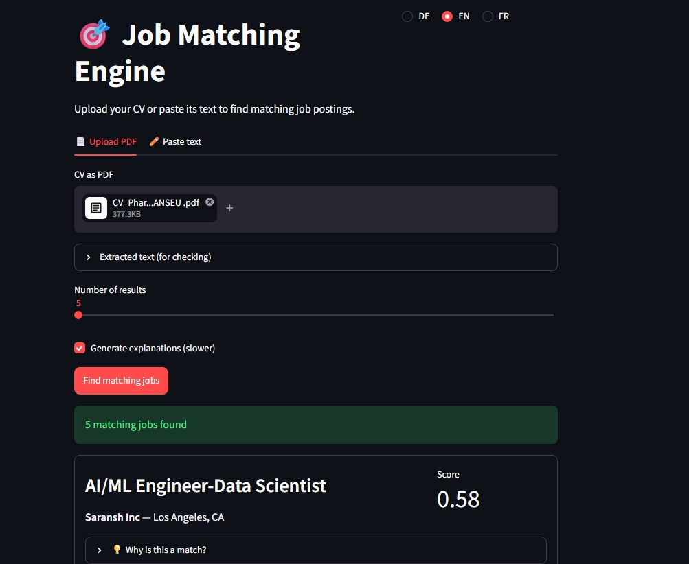
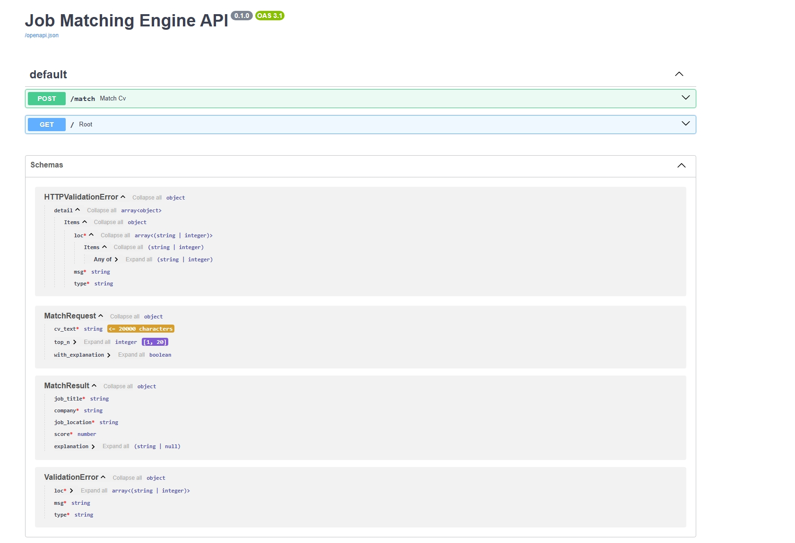

# 🎯 Job Matching Engine

Upload a CV, get a ranked list of matching job postings, and (optionally) a short LLM-written explanation of *why* each posting fits: which skills match, which are missing, and whether the match makes sense.

Works across **German and English** postings with a single multilingual embedding model. The web interface is available in **German, English and French**.

**Live demo:** <https://job-matching-engine-git-29008045200.europe-west3.run.app/ > *(hosted on a free tier: the first request after a period of inactivity can take a few minutes while the service starts)*



---

## How it works

```
CV (PDF or text)
      │
      ▼
 Streamlit UI ──HTTP──▶ FastAPI  POST /match
                           │
                           ├─ encode CV  (paraphrase-multilingual-mpnet-base-v2)
                           ├─ cosine similarity vs. pre-computed posting embeddings
                           ├─ top-N postings
                           └─ (optional) GPT-4o-mini explanation per posting
```

- **Pre-computed embeddings:** the 8,834 posting embeddings are computed once (about 30 minutes on CPU) and loaded at startup, so a request only has to encode the CV.
- **Explanations are opt-in:** each one is an LLM call (latency + cost). If the LLM call fails, the API still returns the scores.
- **Large data files** (`combined_with_scores.pkl`, `job_embeddings.npy`, ~67 MB) are hosted in a Hugging Face dataset and downloaded when the API starts, instead of being committed to Git.

---

## Data

| Source | Content |
|---|---|
| [Kaggle: data-science-job-postings-and-skills](https://www.kaggle.com/datasets/asaniczka/data-science-job-postings-and-skills) | 12,217 LinkedIn postings (US, January 2024) |
| Manually collected | 10 real German *Werkstudent* / *Praktikum* postings (LinkedIn, StepStone, Xing) |

After cleaning and de-duplication: **8,834 postings** (8,824 Kaggle + 10 German).

Cleaning steps (see `notebooks/01_data_exploration.ipynb`):

- drop rows with missing location/skills, drop duplicate links
- strip legal/boilerplate text, **bilingual** (EN + DE) markers, only from the tail of the text. An earlier version stripped from the *first* match and wiped out entire postings; a validation check caught it
- remove administrative (non-technical) postings
- remove reposts: same title + same company under different links (a recruiting agency had reposted the same postings dozens of times and was skewing the rankings)

---

## Method and results

### 1. Baseline: TF-IDF + cosine similarity

The baseline exposed a **language bias**. TF-IDF compares exact words, so the language of the CV dominates the score:

| Setup | Best score | What happened |
|---|---|---|
| English CV, English stopwords | 0.33 | Only English postings could match |
| German CV, English stopwords only | 0.82 | Generic German HR vocabulary ("und", "für", "mit"…) inflated scores; unrelated roles such as *Teamleiter Produktion* ranked high |
| German CV, **EN + DE stopwords** | 0.44 | False positives disappeared; top results were ML / Data Science roles |

A high score here meant "same language", not "better match". This motivated multilingual embeddings.

### 2. Multilingual sentence embeddings

`paraphrase-multilingual-mpnet-base-v2` (768 dimensions) puts German and English text in the same vector space, so no language-specific patching is needed. It was compared with the smaller `paraphrase-multilingual-MiniLM-L12-v2` (384 dimensions).

### 3. Evaluation: Precision@K

48 postings were annotated by hand (23 relevant / 25 not relevant). The sample is the union of each method's top-20 plus 10 low-scoring negatives.

| K | TF-IDF | mpnet-base-v2 | MiniLM-L12-v2 |
|---|---|---|---|
| 5 | 1.00 | 0.40 | 0.60 |
| 10 | 0.50 | **0.70** | 0.50 |
| 15 | 0.53 | **0.67** | 0.60 |
| 20 | 0.55 | **0.60** | 0.55 |

**Reading the table honestly:**

- TF-IDF@5 = 1.00 is a **selection artifact**: its top 5 were mostly the German postings I had hand-picked as relevant in the first place, and they share vocabulary with my German CV.
- From K = 10 on, `mpnet-base-v2` is consistently better, so it is the model used in the app.
- With 48 annotations, a gap of one or two postings moves a score by several points. The trend is clear; the exact numbers are not precise.
- The annotation set was built from the methods' own top results, so it favors them. A fully rigorous evaluation would annotate an independent random sample.

### 4. LLM explanations (RAG-style)

For each returned posting, GPT-4o-mini receives the CV and the posting and answers in a fixed format: **matching skills / missing skills / brief assessment**.

- The prompt forbids mentioning anything not literally present in the CV, and answers in the **language of the CV**
- Low temperature (0.3) to stay factual

This reduces, but does not eliminate, hallucination: treat the explanations as a reading aid, not ground truth.

---

## Project walkthrough

The full story, including what failed, is in **[docs/WALKTHROUGH.md](docs/WALKTHROUGH.md)**: planning, evaluation, API, UI and two deployment attempts. Three key moments:

| Evaluation | API | Deployment |
|---|---|---|
|  |  |  |
| TF-IDF vs. two embedding models | `POST /match` | Memory limit found in the logs and fixed |

---

## Tech stack

Python 3.12 · pandas · NumPy · scikit-learn · NLTK · sentence-transformers (PyTorch) · FastAPI · Pydantic · Uvicorn · Streamlit · OpenAI API · Docker / docker-compose · Google Cloud Run + Cloud Build · Hugging Face Hub (data hosting) · Git (feature branches, issues, Kanban board)

---

## Project structure

```
job-matching-engine/
├── notebooks/01_data_exploration.ipynb   # cleaning, TF-IDF baseline, embeddings, evaluation, RAG prototype
├── src/api/main.py                       # FastAPI service (POST /match)
├── streamlit_app/app.py                  # Streamlit UI (DE / EN / FR)
├── data/                                 # manual postings, annotation set
├── Dockerfile.api
├── Dockerfile.streamlit
├── docker-compose.yml
├── requirements-api.txt
├── requirements-streamlit.txt
└── docs/screenshots/
```

FastAPI and Streamlit pin incompatible versions of Starlette, so each service has its own requirements file and its own image.

---

## Run it locally

**With Docker (recommended):**

```bash
# 1. create a .env file (the OpenAI key is only needed for explanations)
echo "OPENAI_API_KEY=your_key_here" > .env

# 2. build and start both services
docker-compose up --build
```

- Streamlit UI: http://localhost:8501
- API docs (Swagger): http://localhost:8000/docs

On the first start the API downloads the data files from Hugging Face, so an internet connection is required.

**Reproducing the analysis:** open the notebook and run it top to bottom. It downloads the Kaggle dataset through the Kaggle API (credentials required). Re-encoding all postings takes about 30 minutes on CPU.

---

## Design decisions

- **No CV storage.** A CV is personal data. It is processed in memory for the request and not stored on the server. Results live only in the browser session (`st.session_state`) and disappear on refresh, by design. If explanations are enabled, the CV text and the posting text are sent to the OpenAI API.
- **Public API, hardened.** Input limits (CV ≤ 20,000 characters, `top_n` ≤ 20), an optional shared-secret header (`X-API-Key`), a capped number of Cloud Run instances, and a spending limit on the LLM account.
- **Memory.** The model plus data exceeded 2 GiB at startup on Cloud Run, so the API runs with more memory (4 GiB).
- **Deployment path.** Render's free tier (512 MB) ran out of memory, so the project moved to Google Cloud Run, built from the Dockerfiles by Cloud Build.

---

## Limitations and next steps

- **Static snapshot, not a live feed.** The Kaggle data is US postings from January 2024 and only 10 German postings were added by hand. A real German deployment needs fresh postings, for example from an official job API.
- **Small evaluation set** (48 annotations, see above).
- **Cold starts** on the free tier (the first request can take minutes).
- **No fine-tuning** and no evaluation of domain-specific resume/job models: with 48 labels there is too little data to fine-tune, and the models I looked at were English-only, title-only, or much heavier.
- **Scores are similarity, not suitability.** They do not encode seniority or hard requirements (for example, a required Master's degree).
- **Planned:** automated tests (`pytest`) and a GitHub Actions CI pipeline.

---

## Author

**Pharel Harold Nanseu Kombou**: B.Sc. Computer Science student at THM Gießen, focused on Data Science and Machine Learning.
[GitHub](https://github.com/Pharel8) · [LinkedIn](https://linkedin.com/in/pharel-nanseu-042281356)
