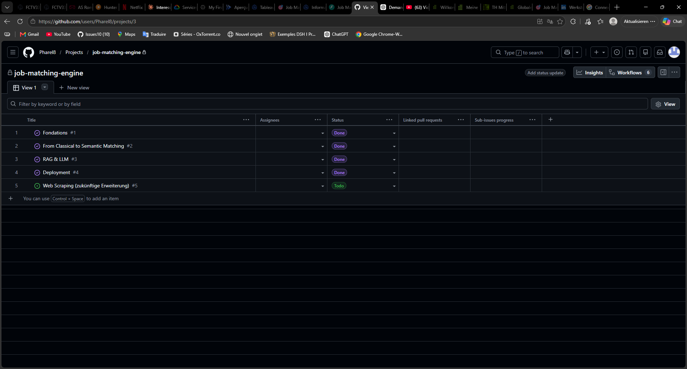
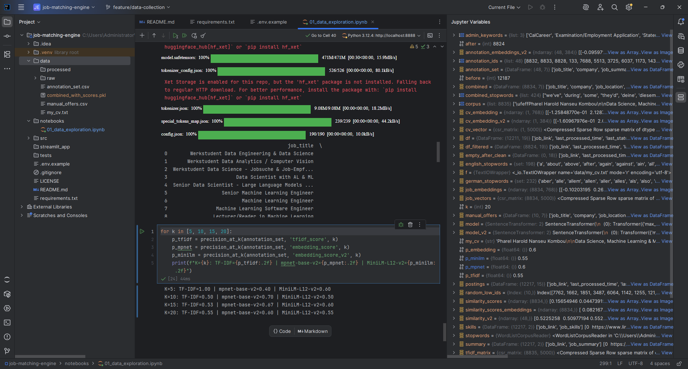
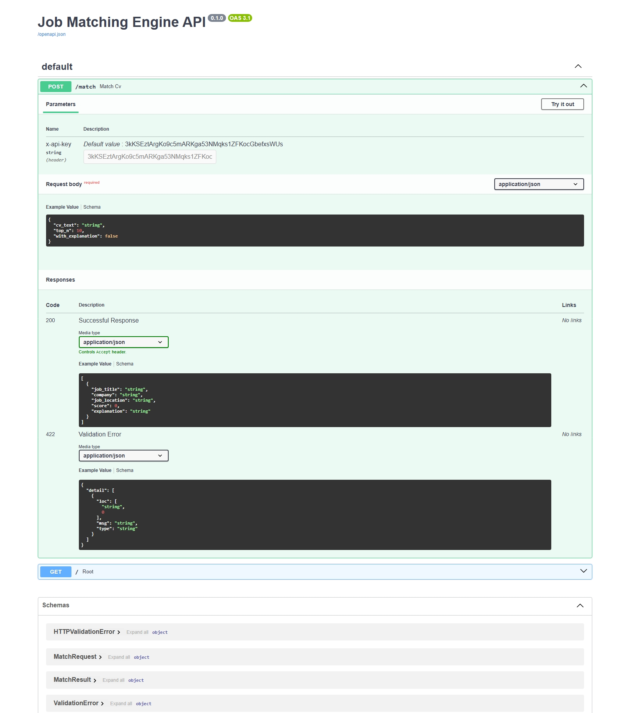
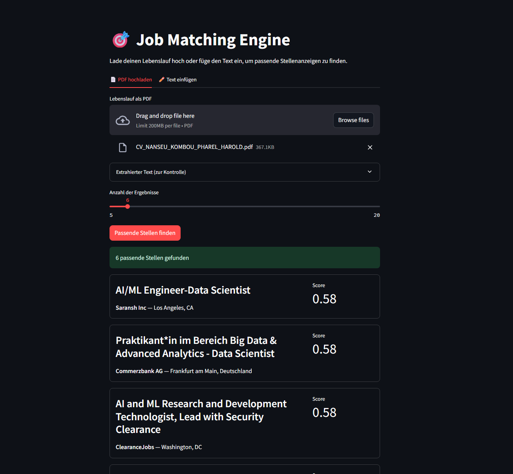
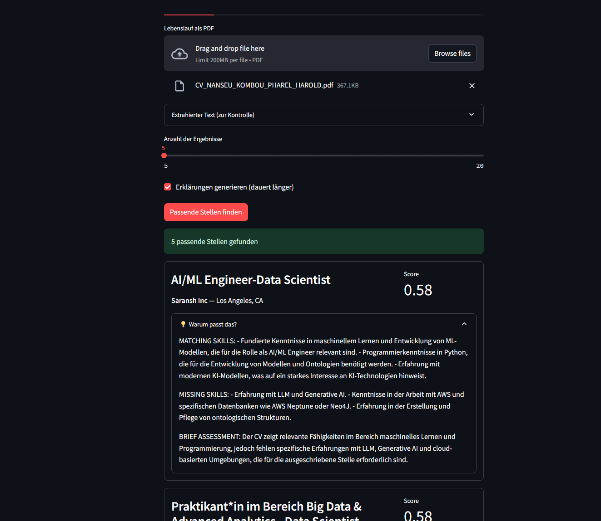
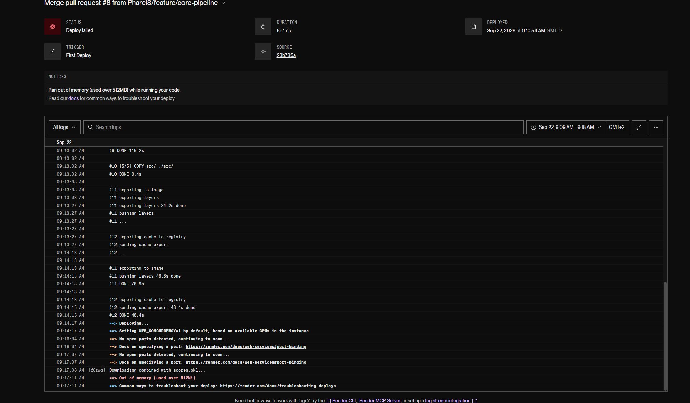
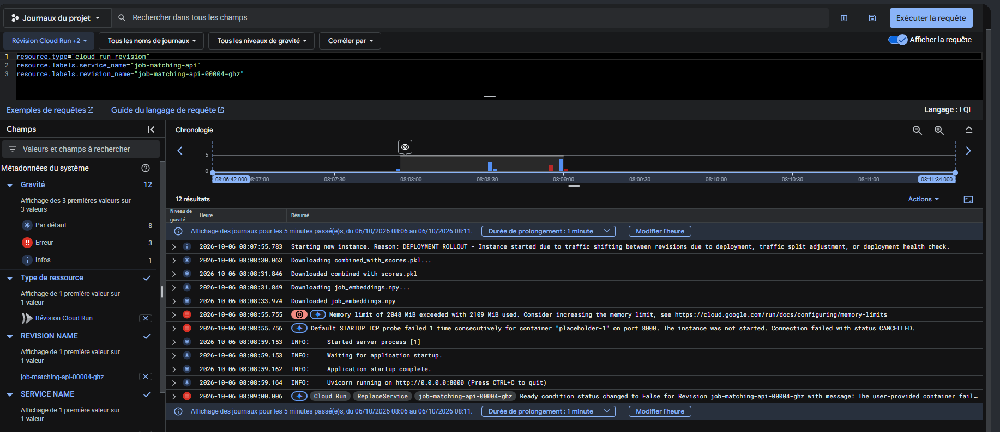
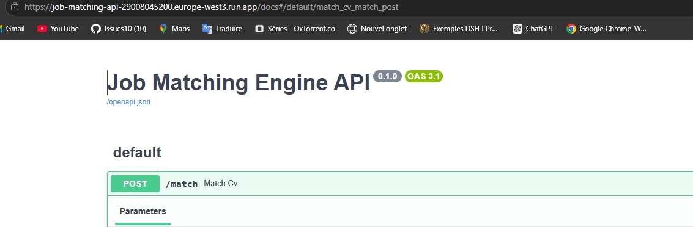

# Project walkthrough

How the project evolved, step by step. The main [README](../README.md) has the summary; this page keeps the evidence, including the things that went wrong.

---

## 1. Planning: issues and Kanban board

The work is split into phases, each tracked as a GitHub issue with a checklist and a Kanban board.



*Phase 1 ("Fondations"): project setup, dataset exploration, manually collected German postings, bilingual text cleaning, CV as structured text.*

---

## 2. Evaluation: TF-IDF vs. two embedding models

Precision@K on 48 hand-annotated postings, computed for the TF-IDF baseline and both embedding models.



```
K=5:  TF-IDF=1.00 | mpnet-base-v2=0.40 | MiniLM-L12-v2=0.60
K=10: TF-IDF=0.50 | mpnet-base-v2=0.70 | MiniLM-L12-v2=0.50
K=15: TF-IDF=0.53 | mpnet-base-v2=0.67 | MiniLM-L12-v2=0.60
K=20: TF-IDF=0.55 | mpnet-base-v2=0.60 | MiniLM-L12-v2=0.55
```

*TF-IDF@5 = 1.00 is a selection artifact (see the README). `mpnet-base-v2` is better from K = 10 on and was kept.*

---

## 3. The API

A FastAPI service exposes `POST /match`. Swagger UI is generated automatically from the Pydantic models.



*Request: CV text + `top_n`. Response: ranked postings with title, company, location and score.*

---

## 4. The web interface

First version: upload a PDF, get ranked postings with scores.



Then LLM explanations (opt-in): matching skills, missing skills, brief assessment, written in the language of the CV.



---

## 5. Deployment, attempt 1: Render (failed)

The first deployment target was Render's free tier (512 MB RAM). The build succeeded, but the service was killed at startup.



*"Ran out of memory (used over 512MB)": a PyTorch + sentence-transformers service does not fit in 512 MB.*

---

## 6. Deployment, attempt 2: Google Cloud Run

Cloud Run allows much more memory per instance. A first revision with 2 GiB still failed, and the logs showed exactly why:



*"Memory limit of 2048 MiB exceeded with 2109 MiB used": a few MiB over the limit. Raising the memory allocation fixed it.*

---

## 7. Live

The API running on Cloud Run, publicly reachable.



---

## What these steps taught me

- **Measure before trusting a score.** A TF-IDF score of 0.82 looked great and meant nothing: it was measuring language overlap.
- **Read the logs.** Both deployment failures were memory problems that the platform logs named explicitly.
- **Treat large files and dependencies as part of the design.** Pre-computed embeddings, data hosted outside Git, and one requirements file per service all came from real failures.
